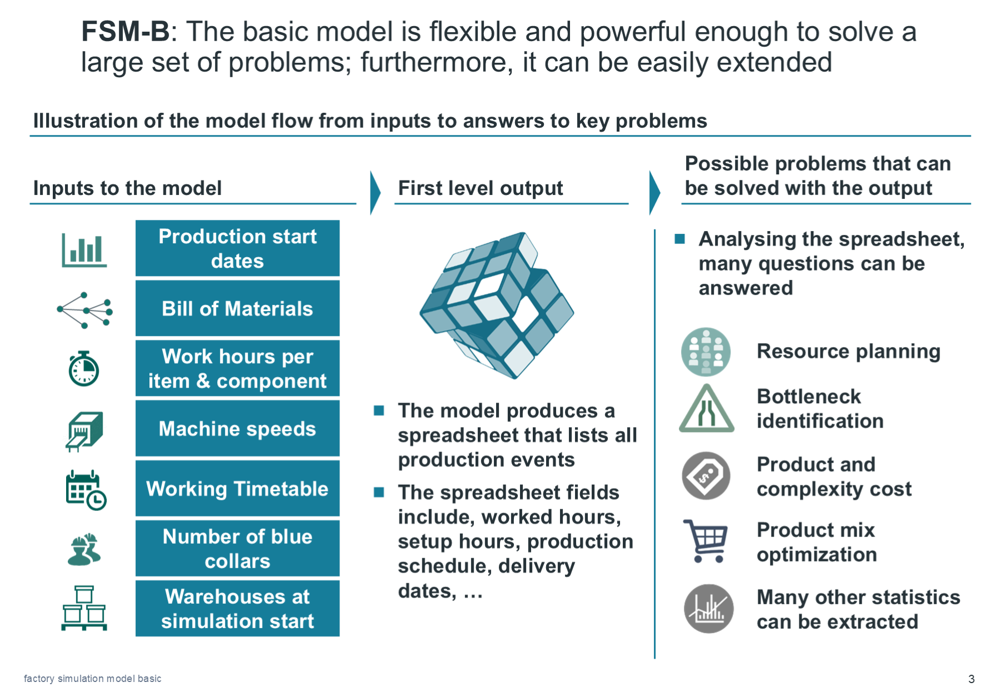
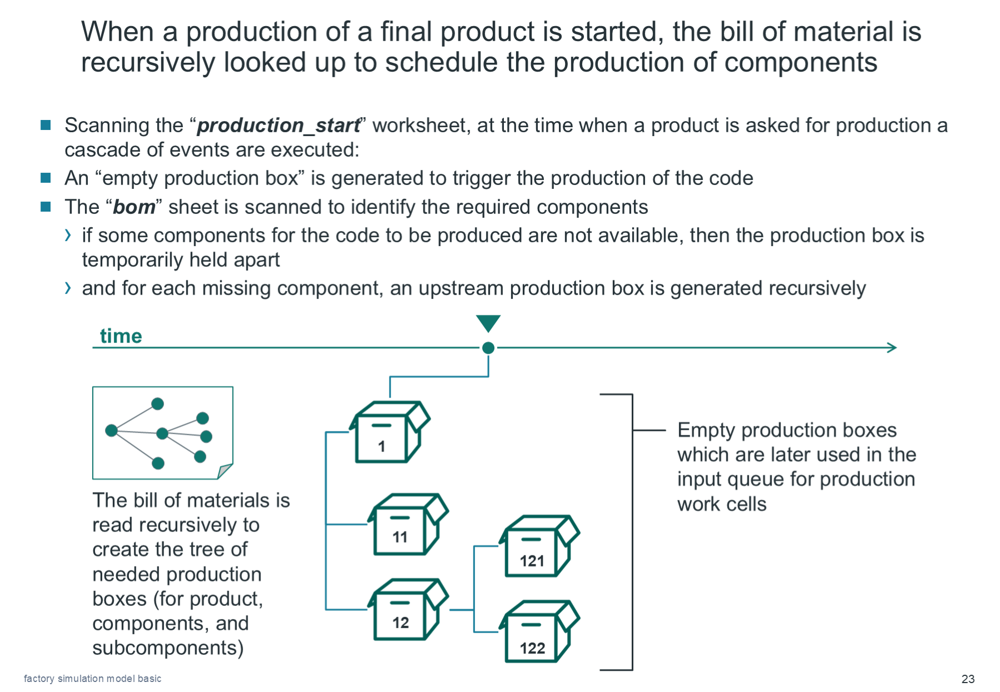
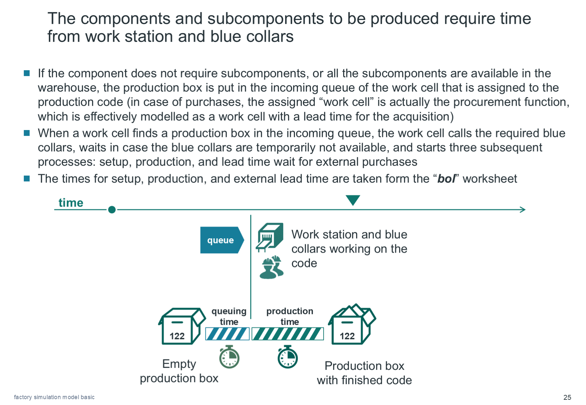
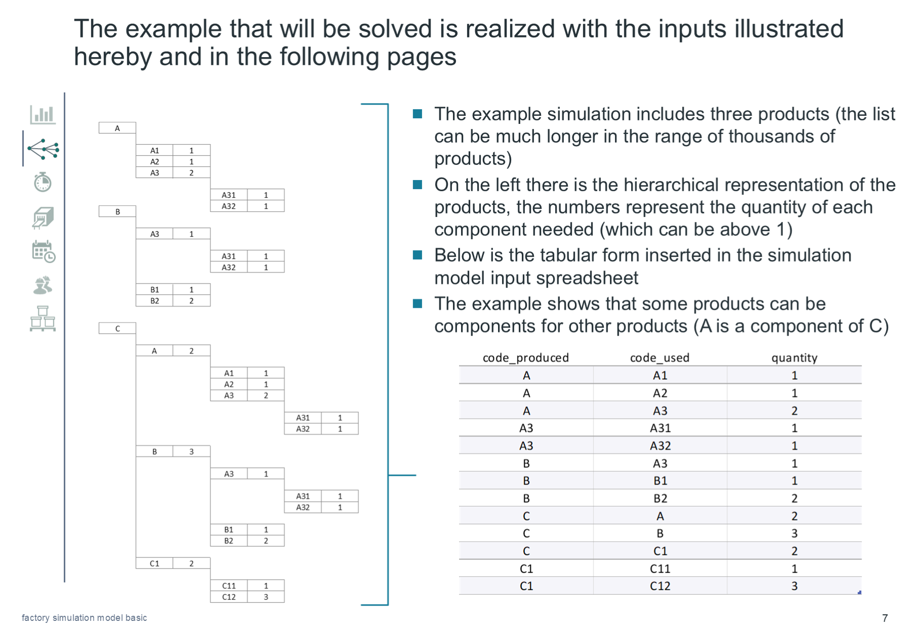
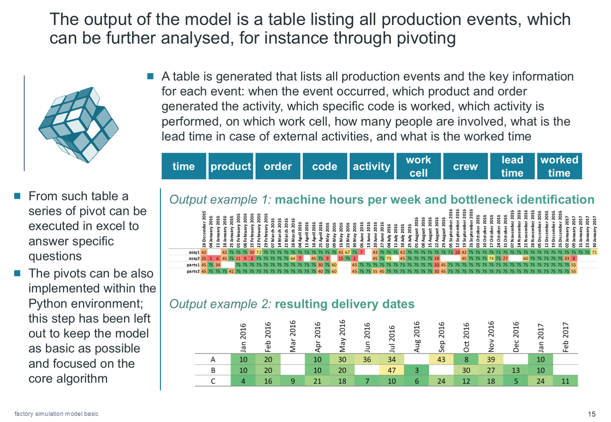

# Factory Simulation Model - Original

## Objective

Assess whether a production plan can meet delivery targets with the available materials, machines, workers, and opening hours.

The model works backward from each requested product through its bill of materials to determine the required components and operations. It then simulates their execution forward from the order release date, calculating completion dates that can be compared with delivery targets.

The [technical note on reverse-time simulation](docs/reverse-time-simulation.md) explains the original design idea: let SimPy's clock advance while interpreting it as movement backward through the factory calendar. It also distinguishes that time mapping from the input and reporting conventions used by the worked examples.



*Model overview, [presentation](factory%20simulation%20model%20basic.pptx), slide 3. The engine exports events; reports are derived from those events.*

## What Is Included

| File | Purpose |
| --- | --- |
| [sim_factory.py](sim_factory.py) | Original Python simulation, implemented with SimPy and pandas. |
| [sim_factory_inputs.xlsx](sim_factory_inputs.xlsx) | Example scenario and Excel input tables. |
| [factory simulation model basic.pptx](factory%20simulation%20model%20basic.pptx) | Model explanation and process diagrams. |
| [docs/reverse-time-simulation.md](docs/reverse-time-simulation.md) | The reverse-time design idea, with a numerical example and its implementation requirements. |
| [docs/worked-examples.md](docs/worked-examples.md) | Two scenarios with downloadable data, results, and execution instructions. |

The simulator runs from the command line. Excel supplies its inputs; CSV event logs support the analysis.

## How It Works

The model uses *discrete-event simulation*: time advances between events such as order releases, shift changes, and operation completions. Component dependencies, queues, and worker availability determine when each operation can start.

1. **Create the factory.** Read the workbook and create a SimPy environment, work cells, input queues, product codes, initial inventories, and a shared pool of production workers.
2. **Release production orders.** At each order's requested start time, create one `ProductionBox` for every requested finished unit. Each box carries its original order and finished-product references.
3. **Resolve component requirements recursively.** Check stock for the requested code first. If stock exists, consume one unit and signal readiness. Otherwise, create boxes for the components listed in the bill of materials and wait for all of them to become ready.
4. **Queue and process the code.** Send the box to its assigned work cell. Each parallel cell processes its queue, performs setup when the code changes, and carries out production subject to its shift calendar and the required workers being available.
5. **Wait for external lead time.** Where configured, complete procurement or another external delay before signalling that the code is ready. The cell can move to another box while this delay runs.
6. **Unblock parent assemblies and record events.** Completed components release waiting parent boxes. The observer records warehouse withdrawals, setup, production, and external lead-time events, then exports the history after the run.

Each `ProductionBox` tracks a requirement for one unit and signals when it is ready. Requirements expand from finished products to components; completed components then release the waiting assemblies.



*Component requirements, presentation slide 23.*



*Work-cell processing, presentation slide 25.*

### Main Objects

| Class | Responsibility |
| --- | --- |
| `SimFactory` | Loads inputs, creates resources, releases orders, and advances the simulation. |
| `ProductCode` | Holds component requirements, work-cell assignment, processing parameters, and stock. |
| `ProductionBox` | Resolves one unit's material requirements and signals when that unit is ready. |
| `WorkCell` | Controls opening hours, setup, production, worker allocation, and external delays. |
| `FactoryObserver` | Collects timestamped events and writes the output files. |

## Excel Inputs

The simulator reads `sim_factory_inputs.xlsx` from its working directory. Seven worksheets define the scenario:

| Worksheet | Key columns | Role |
| --- | --- | --- |
| `production_start` | `order_line_number`, `product_code`, `number_of_products`, `request_time` | Finished-product order releases. `request_time` is an offset in days, converted to simulation hours. Descriptive columns such as `client` and `request_date` are not used to schedule orders. |
| `bom` | `code_produced`, `code_used`, `quantity` | Parent/component relationships and the number of component units required. |
| `bol` | `code_produced`, `work_cell_used`, `setup_time`, `setup_crew`, `production_time`, `production_crew`, `lead_time_days` | Bill of labour: cell assignment, setup and production hours per unit, crew sizes, and external lead time in days. |
| `codes_descriptions` | `code_name`, `description`, `classification` | Product and component catalogue. |
| `work_cells` | `work_cell`, `description`, `department`, `number_of_equal_cells`, `shift_pool` | Work-cell definitions, parallel capacity, and calendar assignment. |
| `initial_warehouse` | `code`, `quantity` | Units already available at the beginning of the simulation. |
| `shifts` | `day`, `date`, `blue_collars_per_shift`, `shift_hours`, `shifts_A` | Daily workforce and opening calendar. A cell's `shift_pool` selects a `shifts_<pool>` column; the example uses pool `A`. |

The bill of materials defines a component tree. A component can have its own components, and a finished product can also be used in another product.



*Bill of materials, presentation slide 7.*

### Scenario Constraints

- Use consistent code and work-cell identifiers across worksheets. Every code needs a bill-of-labour row and a valid cell assignment.
- Keep the bill of materials acyclic. The original code does not detect circular dependencies or validate the workbook schema.
- Use nonnegative durations and whole-number unit counts, component quantities, parallel-cell counts, and crew sizes. The code uses several workbook values directly in `range()` calls.
- Ensure requested crews can be supplied by the workforce calendar. Impossible resource requirements can leave production waiting indefinitely within the simulated horizon.
- The calendar logic assumes up to three eight-hour shift slots per day. `shift_hours` is the working portion of each slot; the remainder is closed time.
- Preserve the example's calendar structure when experimenting. The implementation reads `date` at day index `0`, but selects daily staffing and opening rows using `floor((end_time - env.now) / 24)`. Calendar lookup therefore runs through day indices in descending order even though simulation time advances forward.

## Worked Examples

The [worked examples](docs/worked-examples.md) compare a synthetic factory with one packing cell and six workers against the same production plan with two packing cells and eight workers. Both complete 58 lots across 18 orders. The additional resources increase on-time orders from 5 to 13, while recorded worker-hours rise from 1,061 to 1,107.

The chapter connects the [source dataset](examples/synthetic_factory.xlsx), model inputs, complete event logs, and order-level results, and explains how to interpret the comparison.

## Running the Original Version

### Compatibility First

The tested runtime is CPython 3.7.9 x64, pandas 0.24.2, NumPy 1.19.5, SimPy 3.0.11, and xlrd 1.2.0. The source uses `sheetname` and `.ix`, which require historical pandas versions.

On Windows, create the tested, isolated local runtime and verify the supplied examples:

```powershell
pwsh -File .\scripts\setup_legacy.ps1
pwsh -File .\scripts\run_examples.ps1 -VerifyOnly
```

The [setup script](scripts/setup_legacy.ps1) installs the [pinned dependencies](requirements-legacy.txt) in an isolated `.venv` directory. Windows ARM64 can run the x64 interpreter through emulation. These end-of-life packages should be restricted to isolated historical reproduction. Rebuilding the example inputs requires desktop Excel to calculate formulas; replaying their saved values requires no Excel installation.

The observer's `pd.offsets.Hour(env.now)` rejects fractional hours in pandas 0.24.2, so the examples use whole-hour event times. Fractional-hour inputs require a compatibility change.

### Execute

After creating the local runtime, execute a compatible example directly from its input directory:

```powershell
Set-Location .\examples\01_baseline
& ..\..\.venv\python.exe ..\..\sim_factory.py
```

This writes a new `outputs` directory beside the input. Reference results are available in [examples/01_baseline/results](examples/01_baseline/results) and [examples/02_capacity/results](examples/02_capacity/results). The documented runtime is verified against these two inputs.

The script runs immediately when executed or imported. With `start(step=1)`, it advances to one hour after the start and then at weekly intervals below `max(shifts.day) * 24`. It stops at the last of those intervals rather than the exact calendar end, so a run can leave orders unfinished.

## Outputs and Interpretation

Each execution creates a timestamped directory:

```text
outputs/
  output_YYYY-MM-DD_HHMMSS/
    sim_factory_inputs.xlsx
    production_history.csv
```

The copied workbook preserves the scenario used for that run. The CSV contains the recorded events, with an additional pandas index column because the original exporter uses the default `to_csv()` options.

| Field | Meaning |
| --- | --- |
| `time`, `week`, `month` | Event timestamp and calendar buckets; weeks start on Monday. |
| `product`, `originating_order` | Finished product and original order responsible for the activity. |
| `code` | Product or component involved in the event. |
| `activity` | `take_from_warehouse`, `setup`, `production`, or `external_lead_time`. |
| `work_cell` | Cell responsible for processing, when applicable. |
| `worked_time`, `crew` | Hours in that recorded setup/production segment and workers assigned. |
| `lead_time` | External delay in hours, when applicable. |
| `work_completion` | `work_complete` on the last production segment of a finished-product box. |

Fields are populated only when applicable, so some columns contain blanks. Setup and production may span multiple events when interrupted by closed shifts.



*Event-log analysis, presentation slide 15.*

Typical downstream analyses in Excel or pandas include:

- **Cell workload:** sum `worked_time` for setup and production by `work_cell` and `week`, then compare with the configured opening hours and parallel capacity.
- **Labour demand:** sum `worked_time * crew` by week to obtain worker-hours, rather than machine-hours.
- **Finished production:** filter `work_completion == 'work_complete'` and group by product and order to count units completing production over time.
- **What-if comparisons:** compare event logs from runs with different demand, staffing, calendars, stock, or cell counts.

The completion marker is recorded **before** any subsequent external lead time. It is not automatically a delivery-ready timestamp for a finished product with a nonzero lead time. Finished units satisfied directly from starting inventory generate a warehouse event instead of this marker. The log has no unique per-unit box identifier, so reconstructing individual delivery dates can require additional instrumentation.

## Scope and Limitations

The basic version uses fixed processing and lead times, one assigned work cell per code, FIFO input queues, a shared worker pool, and setup whenever a parallel cell switches product code. Initial stock is consumed before new work is requested; completed boxes signal their requester rather than replenishing a general finished-goods warehouse.

Demand optimization, random breakdowns, learning curves, and purchase costing require extensions. Charts and summaries are produced by the example analysis scripts. Simulation results describe the configured scenario and its scheduling assumptions; they do not establish an optimal production plan.

## Presentation Reference

The [presentation](factory%20simulation%20model%20basic.pptx) covers the model overview (slides 2-3), inputs (6-13), output analysis (15-19), processing logic (21-26), and extensions and historical setup (28-34).