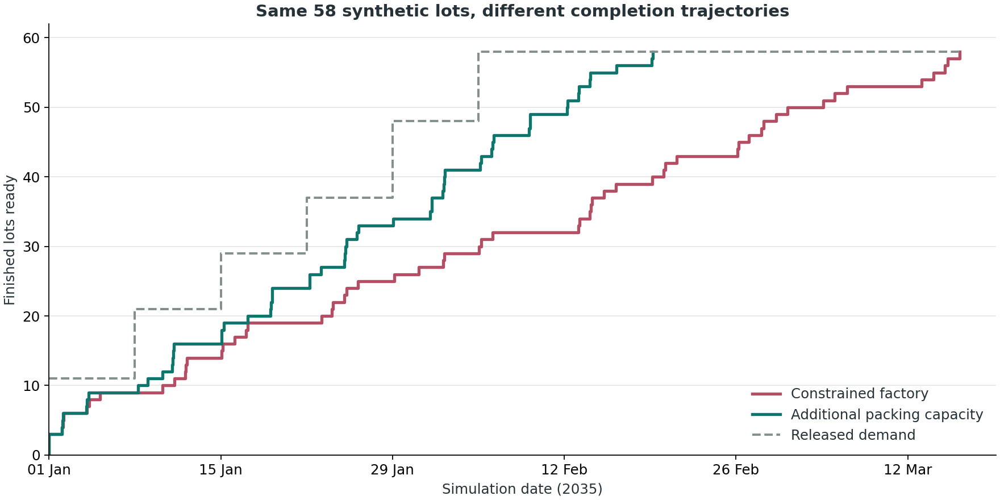
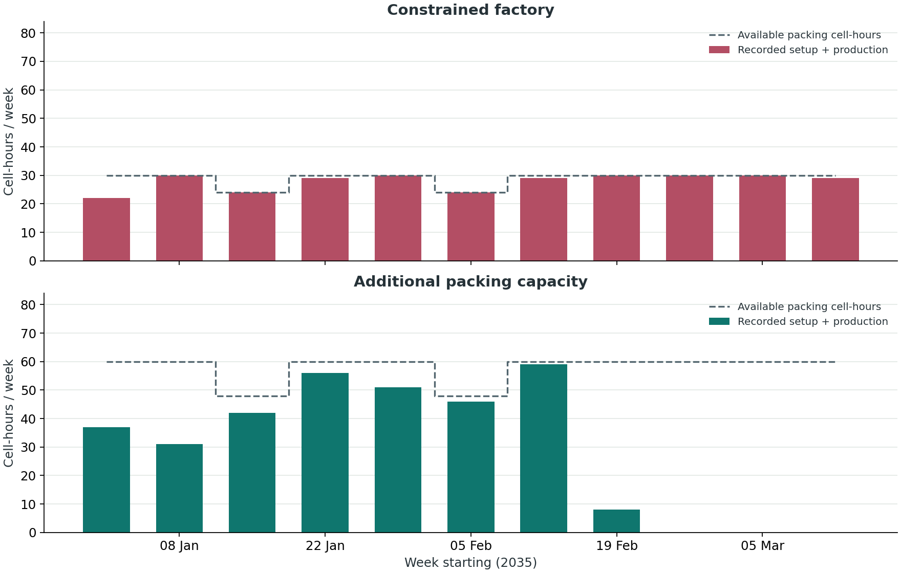

# Worked Examples: Factory Capacity and Order Completion

A production plan assigns quantities and release dates to orders. The model works backward through each product's bill of materials to determine its component and processing requirements. A *discrete-event simulation* then follows their execution forward in time, calculating completion dates from material availability, cell capacity, and shared workers. Comparing those dates with delivery targets shows whether the plan is feasible.

The two examples below compare the same confectionery production plan with different packing capacity and staffing. The plan contains 18 orders for 58 finished lots, released over six weeks, with a target lead time of ten calendar days. All example data are synthetic.

## 1. Factory and Products

The factory has mixing, forming, filling, and packing cells, plus a purchasing function. A *work cell* is a resource that processes one item at a time; parallel cells provide additional processing slots. Production also requires workers from a shared pool, so an idle cell can still wait for its crew.

The [dataset](../examples/synthetic_factory.xlsx) defines three finished products, five intermediate kits, and seven purchased ingredient or packaging kits. Each *model unit* represents one lot or kit of its particular code. Quantities describe relationships between these units; they do not provide a physical mass balance or a conversion to kilograms.

| Finished Product | Code | Packing Hours per Lot |
| --- | --- | --- |
| Cocoa bars | `SYN-FG-01` | 2 |
| Filled bites | `SYN-FG-02` | 4 |
| Gift selection | `SYN-FG-03` | 5 |

A *bill of materials* specifies the components needed to make each code. One gift-selection lot requires one bar lot, one bite lot, and one presentation-box kit. Bar and bite lots have their own intermediate requirements, so an order for gift selections generates work at several levels of the component tree.

The model assigns one work cell to each code. Successive manufacturing stages are therefore represented by intermediate codes: a mixture becomes a formed component, which can then be filled or packed. Production of a parent code starts only after all its required components are ready.

## 2. Model Inputs

The [generator](../scripts/build_examples.py) converts the source tables into the seven worksheets read by the [simulator](../sim_factory.py):

| Source Tables | Model Worksheet | Purpose |
| --- | --- | --- |
| `orders` | `production_start` | Product, quantity, order identifier, and release-day offset. |
| `components` | `bom` | Parent codes, component codes, and required quantities. |
| `operations` | `bol` | Assigned cells, processing times, crew sizes, and external lead times. |
| `products` | `codes_descriptions` | Item identifiers, descriptions, and classifications. |
| `resources`, `scenarios` | `work_cells` | Cell definitions and parallel capacity. |
| `stock` | `initial_warehouse` | Units available before production starts. |
| `calendar`, `scenarios` | `shifts` | Opening hours and available workers for each operating day. |

The *bill of labour*, stored in `bol`, describes how each code is processed. Setup takes one hour whenever a cell changes code, followed by the production time listed above for finished products. The input workbook converts source minutes to hours with formulas such as `=I2/60`; Excel must save the calculated values before the simulator reads them.

Both scenarios use one six-hour shift, Monday to Friday, with shutdowns on 18 January and 8 February 2035. Each order has a target date ten calendar days after release. The `due_date` column supports the lateness analysis; the engine schedules work through its queues without using that deadline as a priority.

## 3. Baseline Scenario

The [baseline input](../examples/01_baseline/sim_factory_inputs.xlsx) provides one cell per activity and six shared workers. Mixing, filling, and packing require two workers; forming requires one. Starting inventory supplies two finished bar lots and one finished bite lot. Missing purchased kits arrive after their configured external lead time.

For each requested lot, a production box tracks the work needed to satisfy it. Available stock satisfies the request immediately; otherwise the box waits for its components and enters the assigned cell's queue. This makes material dependencies, cell occupancy, and worker availability determine the completion sequence.

Order `SYN-ORDER-003` illustrates the effect of shared packing capacity. It requests two gift-selection lots on 1 January, due on 11 January at 00:00. Their bar and bite components also need packing, so the order requires packing work at both the component and final-product levels. It becomes ready on 11 January at 05:00, five hours late.

The [order-completion table](../examples/01_baseline/results/order_completion.csv) defines an order's ready time as the time when all requested lots are available. It includes both final-production completion events and finished-product withdrawals from inventory. Counting only production completions would omit the three lots supplied from stock.

## 4. Capacity Scenario

The [capacity input](../examples/02_capacity/sim_factory_inputs.xlsx) keeps the same products, component quantities, operation times, demand, inventory, and calendar. Only two settings change:

| Setting | Example One | Example Two |
| --- | --- | --- |
| Parallel packing cells | 1 | 2 |
| Shared workers on an open day | 6 | 8 |

The comparison measures the combined effect of extra packing capacity and workers. Isolating the contribution of either change would require another scenario holding the other setting constant.

With these resources, `SYN-ORDER-003` is ready on 9 January at 01:00, before its target. The cumulative curves show how finished-lot availability changes across the whole plan. The gap between released demand and ready lots is the outstanding quantity; the grey curve represents order releases.



## 5. Results and Interpretation

The [comparison CSV](../examples/comparison.csv) summarises the runs:

| Measure | Example One | Example Two |
| --- | --- | --- |
| Requested / completed lots | 58 / 58 | 58 / 58 |
| Orders completed by target | 5 / 18 | 13 / 18 |
| Mean order lead time, calendar days | 19.70 | 7.55 |
| Mean order lateness, calendar days | 10.76 | 0.66 |
| Last finished lot ready | 16 Mar 2035, 05:00 | 19 Feb 2035, 05:00 |
| Recorded worker-hours | 1,061 | 1,107 |
| Setup event segments | 99 | 122 |
| Complete event-log rows | 809 | 827 |

*Order lead time* is the elapsed calendar time from release to readiness of the last lot in that order. The mean gives each order equal weight. *Lateness* is the positive part of ready time minus target time; on-time orders contribute zero. A date at midnight is a precise deadline, so completion later on the same date can still be late.

The capacity scenario completes the same quantity sooner and improves punctuality, but five orders remain late. It also uses 46 additional worker-hours. Each parallel cell tracks its own previous code, so changing the processing sequence changes the number of setups. Extra capacity therefore improves delivery performance here at the cost of more labour.

Event counts measure recorded activity segments. An operation interrupted by a closed shift produces multiple segments, so a difference in event-log length does not imply a difference in finished quantity.

The packing chart compares actual setup-plus-production hours with the calendar's available packing cell-hours. A normal week offers 30 cell-hours in the baseline and 60 with two cells; shutdown weeks offer 24 and 48 respectively.



The baseline packing cell is fully occupied in several weeks while orders wait: a capacity bottleneck. Whole-horizon utilization averages those busy weeks together with later idle time and can hide that constraint. The [weekly workload](../examples/01_baseline/results/weekly_workload.csv) shows when capacity is exhausted; the [cell-utilization table](../examples/01_baseline/results/cell_utilization.csv) measures usage over the full run. Purchasing has zero active-processing hours because its delay is represented by external lead time, which consumes neither workers nor an active cell slot.

## 6. Files and Execution

The simulator exports an event log and a copy of its input workbook. The example scripts derive order dates, workload summaries, and charts from that log.

| Artifact | Example One | Example Two |
| --- | --- | --- |
| Model input | [Workbook](../examples/01_baseline/sim_factory_inputs.xlsx) | [Workbook](../examples/02_capacity/sim_factory_inputs.xlsx) |
| Complete original event log | [CSV](../examples/01_baseline/results/production_history.csv) | [CSV](../examples/02_capacity/results/production_history.csv) |
| Input snapshot | [Workbook](../examples/01_baseline/results/sim_factory_inputs.xlsx) | [Workbook](../examples/02_capacity/results/sim_factory_inputs.xlsx) |
| Console output | [Text](../examples/01_baseline/results/console.txt) | [Text](../examples/02_capacity/results/console.txt) |
| All order completion dates | [CSV](../examples/01_baseline/results/order_completion.csv) | [CSV](../examples/02_capacity/results/order_completion.csv) |
| Weekly machine and labour hours | [CSV](../examples/01_baseline/results/weekly_workload.csv) | [CSV](../examples/02_capacity/results/weekly_workload.csv) |
| Cell utilization | [CSV](../examples/01_baseline/results/cell_utilization.csv) | [CSV](../examples/02_capacity/results/cell_utilization.csv) |
| Measured summary | [JSON](../examples/01_baseline/results/summary.json) | [JSON](../examples/02_capacity/results/summary.json) |
| Runtime versions and file hashes | [JSON](../examples/01_baseline/results/run_manifest.json) | [JSON](../examples/02_capacity/results/run_manifest.json) |

The tested runtime is CPython 3.7.9 x64, pandas 0.24.2, NumPy 1.19.5, SimPy 3.0.11, and xlrd 1.2.0. The [setup script](../scripts/setup_legacy.ps1) installs the [pinned dependencies](../requirements-legacy.txt) in an isolated `.venv` directory. Windows ARM64 can run this x64 interpreter through emulation. These end-of-life dependencies should be restricted to isolated historical reproduction.

From the repository root, generate the data, recalculate the input formulas, run both scenarios, validate the outputs, and create the charts:

```powershell
pwsh -File .\scripts\setup_legacy.ps1
pwsh -File .\scripts\run_examples.ps1
```

The full build requires PowerShell and desktop Microsoft Excel. To replay the supplied inputs and validate their results without Excel, use:

```powershell
pwsh -File .\scripts\run_examples.ps1 -VerifyOnly
```

Verification checks order quantities, starting-stock consumption, cell and worker capacity, and calendar compliance. Replaying the same input reproduces its event log byte for byte; the [validation results](../examples/validation.json) record the outcome. Console elapsed time and Excel file hashes can vary between builds.

## 7. Model Limits

**Time resolution.** The observer constructs timestamps with `pd.offsets.Hour(env.now)`. Pandas 0.24.2 rejects fractional-hour offsets, so these examples use whole-hour event times. Fractional-hour inputs require a compatibility change to the observer.

**Calendar indexing.** The engine selects operating-day rows using `floor((end_time - env.now) / 24)`, so its day index decreases as simulation time advances. For these 112-day inputs, the generator stores simulation day `k` at index `112 - k`. The `date` at index zero supplies the starting timestamp; `simulation_day` and `operating_date` expose the operating-calendar mapping. The [reverse-time technical note](reverse-time-simulation.md) explains the design idea and why these examples retain the observer's forward reporting convention.

**Run horizon.** The input calendar spans 2,688 hours, but `start(step=1)` stops at 2,521 hours, 16 April 2035 at 01:00. Both scenarios complete all demand before then. The validation rejects a run with unfinished orders.

**Finished-product readiness.** Finished codes in these scenarios have zero external lead time, so final production completion also means readiness. With a nonzero external lead time, the marker would occur before readiness. The log has no unique box identifier, which limits reconstruction of individual-unit histories.

**Scenario interpretation.** Processing times and demand are fixed. The comparison measures these two resource configurations under those assumptions; it neither selects an optimal configuration nor estimates performance under random disruptions.

## Sources

[Simulation source](../sim_factory.py), [input generator and analysis](../scripts/build_examples.py), [regression checks](../scripts/verify_examples.py), and [model presentation](../factory%20simulation%20model%20basic.pptx).